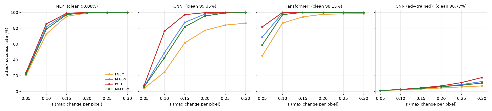
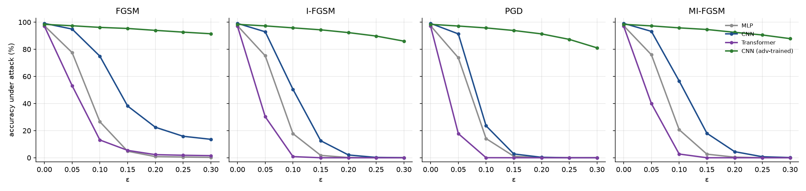
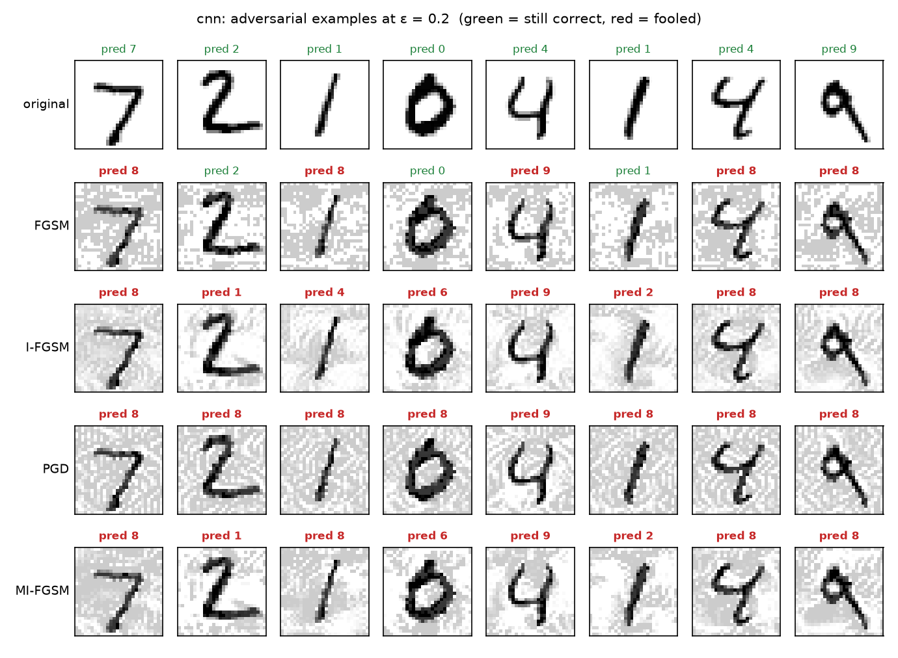
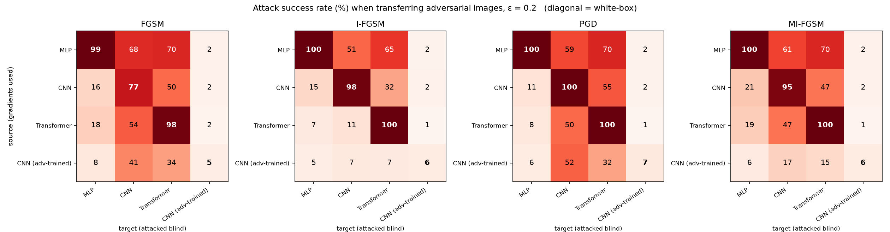

# ai-hw-fall-2026-aa — attacking MNIST classifiers

Train small digit classifiers on the MNIST **train** split, then try to fool them with adversarial attacks on the MNIST **test** split.

**Attacks** (white-box, untargeted, L∞ budget ε on pixels in [0, 1]):

| Attack | Idea |
|---|---|
| **FGSM** | One step of size ε along the sign of the loss gradient |
| **I-FGSM** | Many small steps (α = ε / steps), clipped back into the ε-ball each time |
| **PGD** | I-FGSM from a random starting point with a larger step (α = 2.5 ε / steps) |
| **MI-FGSM** | I-FGSM with momentum on the L1-normalised gradient (μ = 1) |

**Models attacked:** shallow MLP, CNN, Transformer encoder (tiny ViT), and a CNN hardened with PGD adversarial training as a defence.

## Metrics

- **Recognition rate**: accuracy on all 10,000 clean test images, before any attack.
- **Attack success rate (ASR)**: among the test images the model classifies correctly, the share that the attack turns into a wrong prediction.
- Also reported: accuracy under attack, and black-box **transfer** ASR (adversarial images made on one model, shown to another).

## Results

Filled in automatically by `run_all.py` (on GitHub Actions or locally).

<!-- RESULTS:START -->
Recognition rate = accuracy on all 10,000 test images before any attack. ASR = share of correctly classified images that the attack turns into a wrong answer, measured on the first 2,000 test images (10 iterations for I-FGSM / PGD / MI-FGSM).


**Attack success rate at ε = 0.1** (pixels in [0, 1]; 0.1 ≈ 26/255 grey levels)

| Model | Recognition rate (clean) | FGSM | I-FGSM | PGD | MI-FGSM |
|---|---:|---:|---:|---:|---:|
| MLP | 98.08% | 72.7% | 81.7% | 85.5% | 78.7% |
| CNN | 99.35% | 24.4% | 49.1% | 76.2% | 42.8% |
| Transformer | 98.13% | 86.5% | 99.1% | 100.0% | 97.2% |
| CNN (adv-trained) | 98.77% | 2.3% | 2.6% | 2.7% | 2.6% |

**Attack success rate at ε = 0.3** (pixels in [0, 1]; 0.3 ≈ 76/255 grey levels)

| Model | Recognition rate (clean) | FGSM | I-FGSM | PGD | MI-FGSM |
|---|---:|---:|---:|---:|---:|
| MLP | 98.08% | 99.7% | 100.0% | 100.0% | 100.0% |
| CNN | 99.35% | 86.3% | 100.0% | 100.0% | 99.8% |
| Transformer | 98.13% | 98.4% | 100.0% | 100.0% | 100.0% |
| CNN (adv-trained) | 98.77% | 7.1% | 12.6% | 17.6% | 10.7% |
<!-- RESULTS:END -->






Full numbers for every model, attack and ε: `results/summary.csv`, `results/attack_*.json`, `results/transfer.json`.
Slides: [`presentation/Adversarial_Attacks_MNIST.pdf`](presentation/Adversarial_Attacks_MNIST.pdf).

## Method

- **Training.** AdamW, one-cycle learning rate, batch 128. The last 5,000 training images are held out as validation to pick the best epoch; the test set is never used for any training decision.
- **Pixel-space attacks.** Models take raw pixels in [0, 1] and normalise internally, so ε means "each pixel may change by at most ε" (0.1 ≈ 25 of 255 grey levels). ε ∈ {0.05, 0.1, 0.15, 0.2, 0.25, 0.3}; 10 iterations for I-FGSM, PGD and MI-FGSM.
- **Attack set.** Attacks run on the first 2,000 test images (same images for every model) to keep CPU time reasonable; the clean recognition rate uses all 10,000.
- **Defence.** The CNN is fine-tuned for 4 epochs on PGD examples (ε = 0.3, 5 steps) generated on the fly; the epoch with the best PGD accuracy on validation is kept.

## Run it

### On GitHub (no setup)
`.github/workflows/train.yml` installs PyTorch on a GitHub runner, runs everything and commits `results/`, `presentation/`, `saved_models/` and this README back to the repo. It runs on every push that changes the code, or manually: **Actions → Train and attack → Run workflow**.

### Locally
```bash
pip install -r requirements.txt
python run_all.py             # train, attack, transfer test, summary
python make_presentation.py   # build the PDF slides
```

Single steps:
```bash
python train.py --model cnn
python train.py --model cnn --adv-train --init saved_models/cnn.pth
python test.py --model-path saved_models/cnn.pth
python transfer.py
```

## Files

```
models.py             MLP, CNN, Transformer encoder (normalisation built in)
attacks.py            FGSM, I-FGSM, PGD, MI-FGSM
data.py               MNIST loading, train/val split, attack set
train.py              training on the train split (normal or adversarial)
test.py               recognition rate + attack success rates on the test split
transfer.py           black-box transfer between models
run_all.py            whole pipeline + summary tables and charts
make_presentation.py  PDF slides from results/
```
